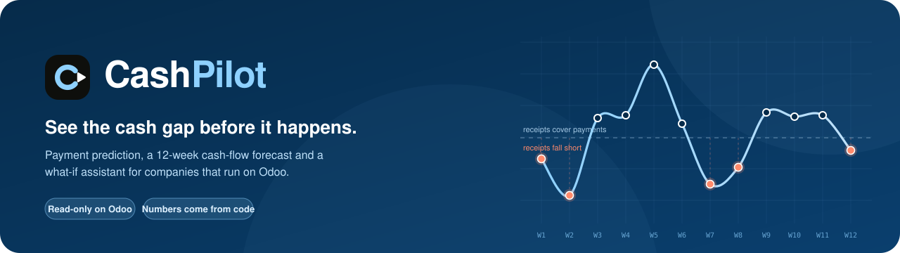
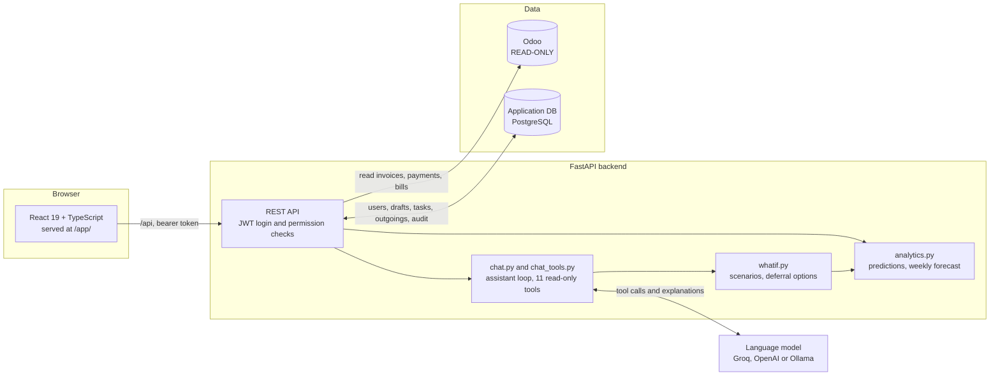
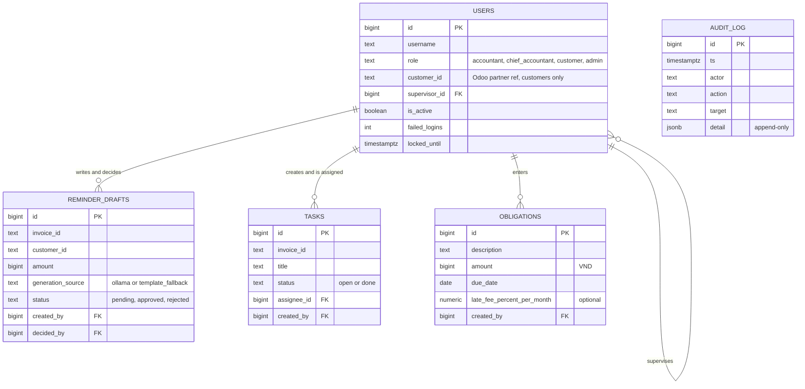
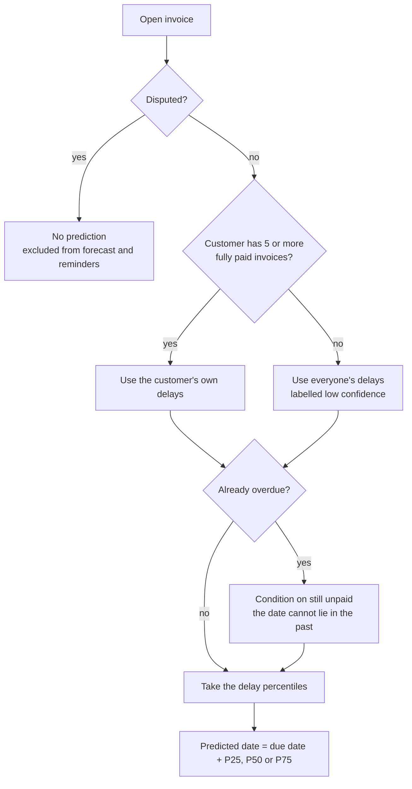
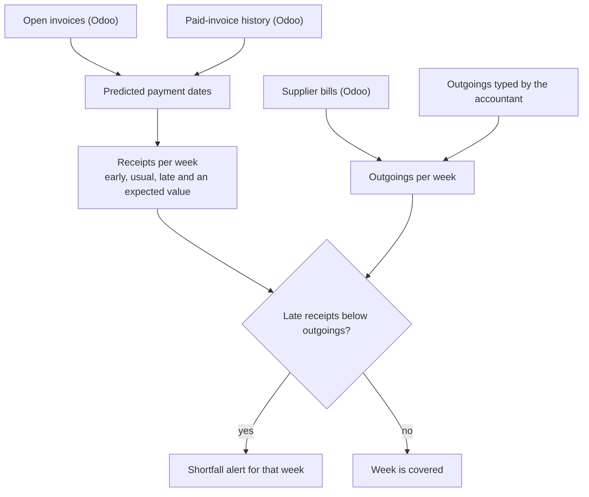
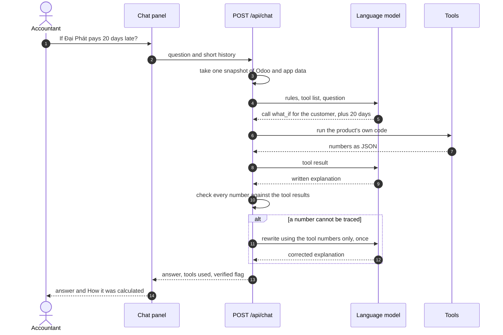
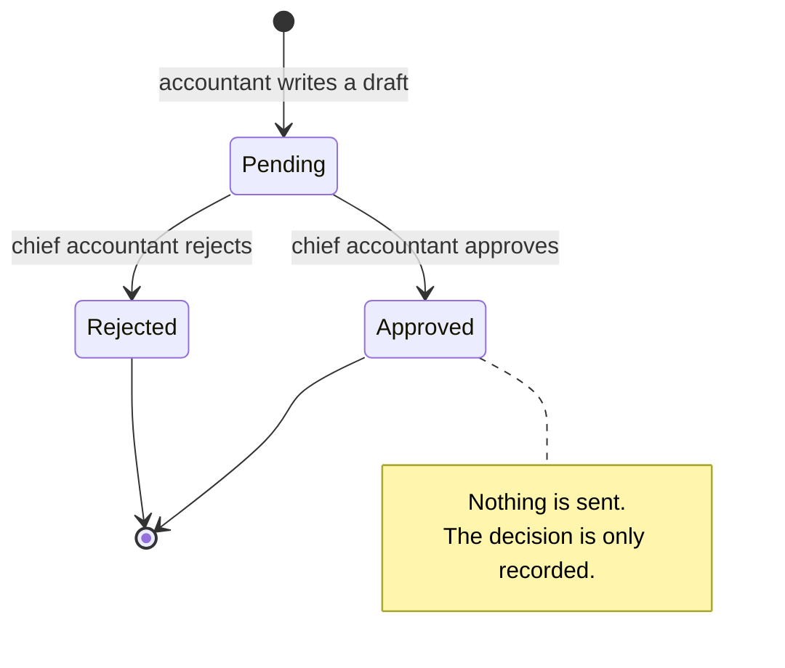

<p align="center">
  
</p>

<p align="center">
  
  
  
  
  
  
</p>

<p align="center">
  <a href="#features">Features</a> ·
  <a href="#quick-start">Quick start</a> ·
  <a href="#architecture">Architecture</a> ·
  <a href="#how-the-numbers-are-calculated">How it calculates</a> ·
  <a href="#chat-assistant">Chat assistant</a> ·
  <a href="#configuration">Configuration</a> ·
  <a href="#api">API</a>
</p>

# CashPilot (ThuTien AI)

A cash-flow and accounts-receivable assistant for small companies that run on Odoo.

It answers three questions an accountant asks every week:

1. **Who will pay late, and by how much?** A payment-date prediction for every open invoice, learned from each customer's own history.
2. **Which weeks will we run short of cash?** A 12-week forecast of money in versus money out, with an alert for every week where the cautious case does not cover the payments due.
3. **What should I do first, and what if...?** A ranked collection list, reminder drafts the accountant reviews, and a chat assistant that re-runs the forecast for "what if" questions.

**Principle: the system reads and calculates, the accountant stays in control.**
Odoo is read-only (nothing is ever written to it), no reminder is sent automatically, and the numbers always come from code,
never from a language model.

## Features

| Area | What it does |
|---|---|
| **Overview** | A 12-week "flight plan": how many weeks are at risk, the worst week and its shortfall, what is owed, overdue and disputed, who pays next and who is likely to pay late |
| **Receivables** | Open invoices with the predicted payment date (early / usual / late) and a confidence label for each |
| **Cash-flow forecast** | Money in per week in three scenarios plus an expected value, money out (Odoo supplier bills plus outgoings typed in by the accountant), shortfall alerts, and the invoices behind every week |
| **Expected outgoings** | The accountant adds rent, payroll, tax... with an optional late fee per month, so the cost of deferring can be compared |
| **Collection priority** | Open invoices ranked by `remaining x late rate x days overdue`, with the reasons a reminder is held |
| **Reminder drafts** | A draft email per overdue invoice; a chief accountant approves or rejects it; nothing is sent |
| **Tasks** | Collection tasks for accountants, assigned by the chief accountant |
| **Chat assistant** | Ask in Vietnamese: "Nếu Đại Phát trả chậm 20 ngày thì sao?", "Khoản nào hoãn được mà ít bị phạt nhất?". The model chooses tools, the backend computes, the model explains |
| **Accounts and audit** | Roles, lock-out after wrong passwords, an append-only audit log |
| **Landing page** | A public product page at the root of the app, sign-in behind it |

## Architecture



- **Every business number comes from Odoo** (customers, invoices, payments, supplier bills). There is no mock or fixture
  data at runtime; if Odoo is unreachable the API answers 502 instead of inventing data.
- The application database holds only what the app itself creates: users and roles, reminder drafts, tasks,
  expected outgoings and the audit log.
- Backend: FastAPI, psycopg with plain SQL, standard-library HTTP for the model clients. Frontend: React with its own
  CSS design tokens (`theme.css`, `brand.css`).

### Application database



Customers, invoices, payments and supplier bills are **not** stored here: they are read from Odoo on demand.

## Quick start

Prerequisites: Python 3.11 or newer (developed on 3.14), a current Node.js LTS (developed on 24), PostgreSQL (the compose file provides one), and Docker if you use the local Odoo.

```powershell
python -m venv .venv
.venv\Scripts\activate
pip install -r backend/requirements.txt
Copy-Item .env.example .env        # then edit .env, see Configuration
```

Two ways to get data, pick one:

**A. Local Odoo in Docker (the default demo)**

```powershell
docker compose up -d              # PostgreSQL on 5433 and Odoo 18 on 8069
```

1. Open http://localhost:8069, create a database named `odoo`, install the Invoicing app.
2. Load the demo invoices (the setup account is only used by this script):

   ```powershell
   $env:ODOO_SETUP_USER="<your Odoo login>"
   $env:ODOO_SETUP_PASSWORD="<your Odoo password>"
   python scripts/seed_odoo.py
   ```
3. Create the read-only Odoo role, then the application database and role (each once):

   ```powershell
   Get-Content scripts/create_readonly_role.sql | docker compose exec -T db psql -U odoo -d odoo
   Get-Content scripts/init_app_db.sql | docker compose exec -T db psql -U odoo -d postgres
   ```

Or run everything with one script (starts PostgreSQL, Odoo and Ollama, creates roles and demo users, builds the frontend, starts the app on port 8001 or the next free one):

```powershell
.\scripts\run_t18_demo.ps1
```

**B. Odoo Online** (see [Data sources](#data-sources)):

```powershell
powershell -ExecutionPolicy Bypass -File .\scripts\run_odoo_online_demo.ps1     # starts on port 8005 or the next free one
```

**Demo accounts and start** (manual route):

```powershell
$env:DEMO_PASSWORD="<choose one, 8+ characters>"
python scripts/seed_users.py      # chief1, accountant1, accountant2, customer1 (linked to C001), admin1

cd frontend; npm ci; npm run build; cd ..
cd backend; python -m uvicorn app.main:app --reload
```

- Web app: http://localhost:8000/app/ · API docs: http://localhost:8000/docs · Health: http://localhost:8000/health
- The tables are created on first start. The frontend is built into `frontend/dist` and served by FastAPI; rebuild it
  (`npm run build`) after changing frontend code, or use `npm run dev` while developing.
- Sign in as `accountant1` or `chief1` to see the forecast and the chat assistant. `customer1` sees only its own invoices.

## Configuration

All settings are environment variables, read from `.env` (ignored by git) when the backend starts. **Restart the backend
after editing `.env`.** A variable already set in the terminal wins over `.env`. `.env.example` lists every variable
with its meaning; the groups are:

| Group | Variables | Notes |
|---|---|---|
| Calculation date | `AS_OF_DATE` | "Today" for all calculations; fixed so demo numbers are reproducible |
| Odoo source | `ODOO_SOURCE` = `local_db` or `online` | |
| Local Odoo | `ODOO_DB_HOST/PORT/NAME`, `ODOO_RO_USER`, `ODOO_RO_PASSWORD` | A read-only database role |
| Odoo Online | `ODOO_ONLINE_URL`, `ODOO_ONLINE_API_KEY`, `ODOO_ONLINE_DB`, `ODOO_ONLINE_DISPUTE_FIELD` | Odoo 19+ JSON-2, Custom plan |
| Application DB | `APP_DB_HOST/PORT/NAME/USER/PASSWORD` or `APP_DB_URL` | Created by `scripts/init_app_db.sql` |
| Login | `JWT_SECRET`, `DEMO_PASSWORD` | `JWT_SECRET` is backend-only; long and random |
| Chat assistant | `CHAT_PROVIDER`, `GROQ_API_KEY`, `OPENAI_API_KEY`, `OPENAI_BASE_URL`, `CHAT_MODEL`, `CHAT_TIMEOUT_SECONDS` | See [Chat assistant](#chat-assistant) |
| Local LLM | `OLLAMA_ENABLED`, `OLLAMA_URL`, `OLLAMA_MODEL`, `OLLAMA_TIMEOUT_SECONDS` | Reminder wording, and the chat when `CHAT_PROVIDER=ollama` |

Put comments on their own line in `.env` (not after a value) and do not quote values. Never put a key in the frontend,
in `.env.example`, in a commit or in a chat message.

## Data sources

### Local Odoo (default)

`ODOO_SOURCE=local_db` reads the Odoo PostgreSQL through a role that can only `SELECT`. Port 5432 is often taken by a local
PostgreSQL, so `docker-compose.yml` maps Postgres to 5433.

### Odoo Online (optional)

Odoo documents External API access for **Custom** plans (One App Free and Standard do not have it). The backend uses the
Odoo 19+ JSON-2 API with an API key. Use a dedicated Odoo user with read access only to what the app needs (invoices,
partners, currencies, invoice lines, payment reconciliations).

```dotenv
ODOO_SOURCE=online
ODOO_ONLINE_URL=https://demo-trading-company.odoo.com
ODOO_ONLINE_API_KEY=<your Odoo API key>
# ODOO_ONLINE_DB=demo-trading-company
# ODOO_ONLINE_DISPUTE_FIELD=x_studio_dispute_status
```

Create the key in Odoo under **My Profile > Account Security > New API Key** and paste only the key value.
`scripts/run_odoo_online_demo.ps1` starts the local PostgreSQL for the app tables, creates a separate `thutien_online`
application database, builds the frontend and starts the backend. It never writes to Odoo Online.

- HTTP 401 from the first check: Odoo rejected the key. Make a new key **inside this Odoo database**; a login password or
  a key from another service is not a JSON-2 key. HTTP 403: access rights or plan limits.
- Only VND invoices and supplier bills are included; other currencies are not converted.
- A dispute is detected from `[DISPUTE]` in the invoice narration or from the optional configured field.
- API errors are shown; the app never silently replaces cloud data with local demo data.

## How the numbers are calculated

All of this lives in `backend/app/analytics.py` as pure functions, and the chat assistant calls the same functions.

### Payment prediction (per open invoice)



- The delay is `payment date - due date` in days, taken from the customer's fully paid invoices.
- A customer needs **at least 5** paid invoices for their own P25 / P50 / P75; with fewer, everyone's delays are used and
  the prediction is labelled **low confidence**.
- An overdue invoice is conditioned on being still unpaid: the prediction cannot lie in the past.
- Disputed invoices get no prediction (they are excluded from the forecast and the reminders).

### Weekly cash-flow forecast (12 weeks, week 1 starts at `AS_OF_DATE`)



| Line | Meaning |
|---|---|
| Early / usual / late receipts | Each invoice is placed in the week of its P25 / P50 / P75 date |
| **Expected receipts** | Each invoice's amount times the probability it is paid in that week, from the customer's whole delay history, shrunk towards everyone's history for customers with little history (weight `n / (n + 2)`) |
| Outgoings | Unpaid Odoo supplier bills by due date plus the outgoings the accountant typed in |
| **Shortfall (gap)** | `max(outgoings - late receipts, 0)`: a week is flagged when even the cautious case cannot cover what is due |

The three scenario lines are stress cases, not a confidence interval. The forecast is not a cash balance: the opening
balance is unknown. Money after the last week is reported (`receipts_out_of_horizon`, `obligations_out_of_horizon`), never
dropped. With no supplier bills and nothing typed in, outgoings are 0 and no week is flagged.

### What-if and deferral (`backend/app/whatif.py`)

A scenario can shift a customer's payments by N days, mark a customer as paying now, delay every customer, defer an
outgoing by N days, or add a hypothetical outgoing. The forecast is re-run with the **same code** and compared with the
base: weeks that become short, weeks that stop being short, the shortfall before and after. For deferral, the cost is
`amount x monthly fee x days / 30` and is shown **only when a fee is known**. Odoo supplier bills carry no penalty terms,
so unless the accountant entered a late fee on the outgoing, the cost is reported as unknown, not guessed.

### F3 collection priority

`GET /api/f3/priority` ranks open invoices by `remaining_amount x late_rate x days_overdue`. `late_rate` comes from the
customer's fully paid history, then global history, then an explicitly labelled 0.5 assumption. Ties use remaining
balance and invoice id. A reminder draft is allowed only when the invoice is overdue, has a positive balance and a contact
email, is not disputed, and has no pending draft. The score is a work-queue heuristic, not a claim about payment.

## Chat assistant

Accountants and chief accountants get an **"Hỏi trợ lý"** button (bottom right). Example questions:

- Tuần nào mình thiếu tiền nhiều nhất? · Nếu Đại Phát trả chậm 20 ngày thì sao? · Nếu mọi khách trả trễ thêm 7 ngày?
- Khoản nào hoãn được mà ít bị phạt nhất? · Hoãn khoản nào thì giảm thiếu tiền nhiều nhất?
- Khách nào có khả năng trả trễ nhất? · Hóa đơn INV/... dự kiến khi nào được trả? · Dự báo này tính thế nào?

### How it works



1. The question reaches `POST /api/chat`. The backend takes **one snapshot** of the data, so two tools in one answer never
   disagree.
2. The model sees only a tool list and chooses read-only tools: `get_overview`, `search_customers`, `get_customer`,
   `list_invoices`, `get_invoice`, `get_forecast`, `get_week_detail`, `list_outgoings`, `what_if`, `defer_options`,
   `explain_method`. There is no free SQL and no tool that writes.
3. The tools run the product's own functions and return numbers. The model writes the explanation, in Vietnamese.
4. **Number check:** every figure of 1,000 or more (and every amount with "triệu/tỷ") in the answer must appear in a
   tool result or in the user's own text. Untraceable figures are sent back to the model once; if they remain, the answer
   is shown with a warning listing them. Small counts and years are not checked.
5. The panel's "Cách tính" lists the tools and arguments used, so the user can see where an answer came from.

### Safeguards

- Read-only: the assistant cannot send reminders or change data, and says so when asked.
- Customer names and invoice text are treated as data, not instructions (stated in the system prompt and results are passed
  as JSON). Chat history from the browser is limited to user/assistant text; it cannot forge tool or system turns.
- Needs `forecast:read`; customers and admins get 403. Limited to 15 questions per user per minute.
  Every question, the tools used and the verification result are written to the audit log; failures record the reason.
- If the model is not configured, the endpoint answers 503 and the panel says so. A provider rate limit is retried once
  after the wait the provider asks for (at most 20 s), then shown as "wait a minute".
- If a name matches several customers, the assistant asks which one.

### Choose a model

Set `CHAT_PROVIDER` (the model must support tool calling). Restart the backend after changing `.env`.

| Provider | `.env` | Notes |
|---|---|---|
| **Groq** | `CHAT_PROVIDER=groq`, `GROQ_API_KEY=...` | Fast (answers in seconds), free tier. Default model `openai/gpt-oss-120b`; set `CHAT_MODEL` to change. The free tier limits tokens per minute (8,000 for this model), so about two questions a minute |
| **OpenAI** | `CHAT_PROVIDER=openai`, `OPENAI_API_KEY=sk-...` | Default `gpt-4o-mini`. Needs API credit; a ChatGPT Plus subscription does not include API access |
| **Ollama** | `CHAT_PROVIDER=ollama`, `OLLAMA_URL=...`, `OLLAMA_MODEL=...` | Stays on your network. On CPU only, a 4B model needs minutes per question and may exceed `CHAT_TIMEOUT_SECONDS`; use a GPU machine (e.g. a teammate's, reached through an ngrok URL) |
| Off | `CHAT_PROVIDER=off` | |

**Privacy:** with Groq or OpenAI the question and the tool results (customer names, invoice ids, amounts) are sent to that
company. Use Ollama to keep them in-house.

**Limits you should know:** the numbers are computed by code and checked, but the model decides which tool to call and how
to phrase the result, so a small model can pick the wrong tool or misread a result. The "cost of deferring" is available
only for outgoings that have a late fee entered. Forecasts are estimates and the assistant is told to say so.

## Reminder drafts and the local LLM (optional)

For overdue invoices the accountant creates a draft email. With `OLLAMA_ENABLED=1` a local Ollama model writes **two generic
Vietnamese sentences**; it is never sent customer, invoice, amount, date or email data. The backend inserts those facts from
Odoo, validates the model output and saves the draft. If Ollama is unavailable, times out or returns invalid text, a fixed
template is used and labelled as such. A chief accountant approves or rejects; **approving only records the decision**, the
system has no email sender.



## Roles and permissions

| | Nhân viên kế toán | Kế toán trưởng | Khách hàng | Admin |
|---|---|---|---|---|
| Invoices, payments, summary | all | all | own only | no |
| Payment predictions, 12-week forecast, chat assistant | yes | yes | no | no |
| Enter expected outgoings (`obligation:write`) | yes | yes | no | no |
| Write reminder drafts | yes | yes | no | no |
| Approve or reject drafts | no | yes | no | no |
| Own collection tasks | yes | yes | no | no |
| Team's tasks, assign tasks | no | yes | no | no |
| Users, roles, audit log | no | no | no | yes |

- A chief accountant supervises accountants (set by the admin) and sees the team's drafts and tasks only.
- A customer account is linked to one Odoo customer id and sees only that customer's invoices and payments.
- Self-registered accounts are customers linked to nothing, so they see no data until an admin links them.
- The matrix lives in `backend/app/permissions.py`; endpoints check permissions, not role names. Role and active flag are read
  from the database on every request, so a change applies immediately.
- Passwords are hashed (scrypt). After 5 wrong passwords an account is locked for 15 minutes.
- The audit log is append-only (a database trigger blocks UPDATE and DELETE) and masks passwords and tokens.

## API

Interactive docs at `/docs`. Everything except login and registration needs a bearer token.

| Area | Endpoints |
|---|---|
| Auth | `POST /api/auth/login`, `register`, `logout`, `change-password`; `GET /api/auth/me` |
| Data | `GET /api/invoices/open`, `/api/payments/history`, `/api/summary`, `/api/predictions`, `/api/forecast` |
| Outgoings | `GET /api/obligations`, `POST /api/obligations` (description, amount in VND > 0, due date, optional `late_fee_percent_per_month` 0 to 100) |
| Priority | `GET /api/f3/priority` |
| Reminders | `GET /api/reminders/candidates`, `GET/POST /api/reminders/drafts`, `GET/PATCH /drafts/{id}`, `/drafts/{id}/history`, `POST /drafts/{id}/approve`, `/reject` |
| Tasks | `GET /api/team`, `GET/POST /api/tasks`, `PATCH /api/tasks/{id}` |
| Chat | `GET /api/chat/status`, `POST /api/chat` (`question`, optional `history`) |
| Admin | `GET/POST /api/admin/users`, `PATCH /api/admin/users/{id}`, `POST /api/admin/users/{id}/password`, `GET /api/admin/customers`, `GET /api/admin/audit` |
| Health | `GET /health` (also says whether the application database is reachable) |

If Odoo is unreachable the API returns 502; if the application database is unreachable, 503. It never falls back to made-up data.

## Tests

```powershell
cd backend
$env:APP_DB_PASSWORD="change-me"
$env:ODOO_DB_PORT="5433"; $env:ODOO_RO_USER="thutien_ro"; $env:ODOO_RO_PASSWORD="change-me"
python -m pytest -q                      # the full suite takes a few minutes

cd ../frontend
npm test                                  # forecast math, prediction display, chat markdown
npx tsc --noEmit -p .                     # type check
npm run build
```

- API tests use the `thutien_test` database (created by `init_app_db.sql`, emptied between tests) and never touch
  `thutien_app`. Permission and workflow tests replace Odoo with an in-memory fake, so the expected data is known.
  `test_odoo_integration.py` reads the real Odoo database and is skipped when it is not configured.
- The chat tools are tested on a small data set whose numbers were worked out by hand (`test_chat_tools.py`, `test_whatif.py`).
  The model clients (Groq/OpenAI/Ollama request and response shapes, errors, rate limits, key never leaked) and the assistant loop
  (tool use, bad number, retry, history) are tested with mocked HTTP and a scripted model, so the suite needs no key and no
  network. It therefore proves the plumbing and the safety checks, not how a particular real model behaves; try your model
  with the example questions before a demo.

## Research

`research/` holds experiments that are **not** part of the product:

- `payment_ml`: does a machine-learning model beat the customer's own median delay? It is a comparison, not a feature: ML would
  be adopted only if it clearly wins. See `research/README.md` for the dataset licence, how to run it and the decision rule.
- A weekly cash-flow backtest of the production forecast rule (`research/payment_ml/cashflow.py`).
  Results are written to `research/results/` (git-ignored); no figure should be quoted without running it on the data.

## Project layout

```
backend/app/
  analytics.py          predictions, weekly forecast, expected receipts, week contributions
  whatif.py             scenarios and deferral options
  chat.py, chat_tools.py, chat_data.py, llm.py, routes_chat.py     the assistant
  f3_priority.py        collection priority
  odoo_reader.py, odoo_online.py                              read-only Odoo access
  permissions.py, auth.py, users.py, security.py              roles, login, lock-out, hashing
  routes_*.py           API (data, F3, reminders, tasks, obligations, admin, chat)
  schema.sql, db.py, audit.py, drafts.py, tasks.py, obligations.py   application database
backend/tests/          automated tests
frontend/src/           React app: App.tsx (shell), FinancePages.tsx, Operations.tsx, ChatPanel.tsx,
                        FlightPath.tsx, Landing.tsx, forecast/ (chart and page), theme.css, brand.css
fixtures/, scripts/     demo data and setup scripts (seed_odoo.py, seed_users.py, run_*.ps1, *.sql)
research/               experiments (not part of the product)
```

## Troubleshooting

| Symptom | Cause and fix |
|---|---|
| Chat panel says it is not configured | No provider in the environment, or the backend was not restarted after editing `.env` |
| Chat answers "không trả lời được" (502) | The model call failed. The reason is in the audit log (admin screen, action `chat_failed`): 401/403 = wrong key, 404 = the model does not exist for your account (set `CHAT_MODEL`), timeout = slow model (raise `CHAT_TIMEOUT_SECONDS`) |
| Chat answers "Đợi khoảng một phút" (429) | The provider's per-minute token limit; wait or use a plan with higher limits |
| The new UI does not show | The browser cached the old build: Ctrl+F5. Rebuild with `npm run build`; make sure you run the branch you think you do |
| `.env` change has no effect | The backend reads `.env` at start-up only; a variable set in the terminal overrides it |
| API returns 502 on every data page | Odoo is unreachable or the read-only role/API key is wrong |
| API returns 503 | The application database is unreachable; check `APP_DB_*` and `/health` |
| Everything looks empty for a customer account | The account is not linked to an Odoo customer id; an admin links it |

